# Taller: Análisis de requisitos, del proyecto al modelo

**Materia:** Ingeniería de Requisitos
**Unidad II:** Elicitación y análisis de requisitos
**Duración:** 80 minutos
**Modalidad:** equipos de 3 o 4 estudiantes
**Entregable:** este mismo archivo `.md` completado (más su exportación a PDF)

---

## 0. Datos del equipo

| Campo | Respuesta |
|---|---|
| Nombre del proyecto | MediConnect Plus: Sistema Inteligente de Gestión Hospitalaria y Telemedicina |
| Integrantes | Dania Gutiérrez y Grecia Santiago |
| Fecha | 21/10/2026 |

**Roles del equipo** (asignen uno por persona; en equipos de 3, una persona toma dos roles):

| Rol | Responsable | Función |
|---|---|---|
| Analista líder | Dania Gutiérrez | Coordina el tiempo y revisa la coherencia del documento |
| Modelador | Grecia Santiago | Escribe y renderiza los diagramas PlantUML |
| Arquitecto | Grecia Santiago | Propone la arquitectura y la matriz de trazabilidad |
| Relator | Dania Gutiérrez | Documenta la negociación y presenta la conclusión final |

---

## Objetivo

Producir un mini documento de análisis de requisitos de su proyecto real que cubra los cinco elementos de la unidad: **clasificación, modelamiento conceptual, diseño arquitectónico y asignación, negociación y análisis formal**.

Este documento está redactado para que un equipo de desarrollo pueda construir el sistema sin tener que interpretar: cada requisito es atómico (una sola cosa), tiene criterio de aceptación medible y está trazado a un interesado y a un componente. Todo valor que no salió de una negociación o de la entrevista se marca como **supuesto** (ver sección 1.2 y Anexo A) para que no se confunda con una instrucción del cliente.

## Distribución del tiempo

| Tiempo | Bloque | Producto |
|---|---|---|
| 0-10 min | Contexto | Problema, alcance e interesados |
| 10-25 min | 1. Clasificación | Tabla de requisitos clasificados y priorizados |
| 25-40 min | 2. Modelamiento conceptual | Diagrama de casos de uso y diagrama de clases (PlantUML) |
| 40-50 min | 3. Arquitectura y asignación | Diagrama de componentes y matriz de trazabilidad |
| 50-62 min | 4. Negociación | 2 conflictos resueltos con formato WinWin |
| 62-75 min | 5. Análisis formal | 3 requisitos reescritos y verificados |
| 75-80 min | Cierre | Revisión, entrega y conclusión oral de 1 minuto |

> **Tip de tiempo:** el Modelador puede empezar los diagramas del bloque 2 mientras los demás terminan la clasificación. Si el tiempo no alcanza, reduzcan a 8 requisitos y hagan solo el diagrama de casos de uso.

---

## Bloque de contexto (0-10 min)

### Descripción del proyecto

> La red privada de salud MediConnect Plus (3 hospitales, 10 clínicas y un servicio de telemedicina) opera con sistemas aislados y registros en papel, lo que causa retrasos en citas, recetas duplicadas y falta de trazabilidad. El proyecto es el núcleo transaccional web y móvil que unifica citas, expediente clínico único, recetas electrónicas con reserva en farmacia y videoconsultas cifradas. **Incluye:** gestión de citas y lista de espera, expediente, consulta, receta y telemedicina. **No incluye:** facturación, seguros, laboratorio ni imagenología. Beneficia a pacientes, médicos, personal de recepción y a la dirección médica de la red.

### Alcance

| Dentro del alcance | Fuera del alcance (no construir) |
|---|---|
| Registro y acceso de usuarios con roles | Facturación y cobros |
| Agenda médica, citas, notificaciones y lista de espera | Seguros y convenios |
| Urgencias sin turno (solo registro de llegada y cola) | Resultados de laboratorio |
| Expediente clínico único, consulta, alergias y diagnósticos | Imagenología |
| Receta electrónica y reserva de medicamentos en farmacia | Gestión del inventario de farmacia (es del Sistema de Farmacia externo) |
| Videoconsulta cifrada de extremo a extremo | Grabación o almacenamiento de videollamadas |
| Auditoría inmutable y su consulta | Triage clínico de urgencias |

### Glosario

| Término | Significado en este documento |
|---|---|
| Cupo | Un horario de un médico, en una fecha y hora, que puede ocupar una sola cita activa |
| Cita activa | Cita en estado Agendada, Notificada, Confirmada, EnSalaEspera, TelemedicinaConectada o EnConsulta |
| Personal clínico | Médicos y enfermeros |
| Relación asistencial | Tener una cita vigente asignada con el paciente, o una urgencia activa del paciente en su sede (ver RN-07) |
| Segundo factor (2FA) | Código temporal de un solo uso generado por una aplicación autenticadora (TOTP) |
| WORM | Almacenamiento de escritura única: los registros no se pueden editar ni borrar |
| Addendum | Nota adicional que corrige o complementa una nota clínica ya firmada, sin modificarla |
| Surtida | Receta cuyos medicamentos ya fueron entregados por la farmacia |

### Interesados (mínimo 4)

| # | Interesado | Rol | Qué espera del sistema |
|---|---|---|---|
| 1 | Dra. Elena Ruiz | Directora Médica | Expediente único por paciente en toda la red, diagnóstico CIE-11, receta electrónica ligada a farmacia y alerta de alergias |
| 2 | Carlos Mendoza | Coordinador de Recepción y Citas | Agenda ordenada, confirmación por correo o SMS, liberación automática de cupos y registro de urgencias sin turno |
| 3 | Ing. Mónica Valdés | Seguridad e Infraestructura | Cumplimiento HIPAA, 2FA, auditoría inmutable y videollamadas cifradas de extremo a extremo |
| 4 | Pacientes | Usuarios finales | Agendar, reprogramar y cancelar sin filas, recibir recordatorios y consultar por videollamada |
| 5 | Médicos y enfermeros | Personal clínico | Acceso rápido al expediente y a las alergias durante la consulta, sin pasos que retrasen la atención |
| 6 | Servicio de Farmacia | Sistema externo | Recibir recetas y reservas de medicamentos con inventario actualizado |
| 7 | Dirección de Transformación Digital | Patrocinador | Primera versión dentro del presupuesto, sin redundancia total de todos los servicios |

### Roles y matriz de permisos

El sistema tiene seis roles. Esta matriz es la fuente para RF-03 y se debe probar celda por celda.

| Acción | Paciente | Recepción | Médico | Enfermero | Seguridad | Administrador |
|---|---|---|---|---|---|---|
| Ver disponibilidad; agendar, reprogramar y cancelar citas | Solo las propias | Sí, a nombre de cualquier paciente | No | No | No | No |
| Registrar urgencia sin turno | No | Sí | No | No | No | No |
| Gestionar agenda médica (horarios y bloqueos) | No | Sí, en su sede | No | No | No | Sí |
| Ver datos administrativos del paciente (nombre, contacto, citas) | Solo los propios | Sí | Con relación asistencial | Con relación asistencial | No | No |
| Ver expediente clínico completo | Resumen propio (RF-16) | No | Con relación asistencial (RN-07) o por emergencia (RF-23) | Con relación asistencial (RN-07) | No | No |
| Capturar signos vitales y alergias | No | No | Sí | Sí | No | No |
| Capturar diagnóstico y notas; emitir o anular receta | No | No | Sí | No | No | No |
| Consultar auditoría (solo lectura) y recibir alertas de emergencia | No | No | No | No | Sí | No |
| Administrar usuarios, roles y catálogos | No | No | No | No | No | Sí |

> **Regla transversal:** ningún rol puede editar ni borrar registros de auditoría, y el Administrador nunca ve datos clínicos.

---

## Bloque 1. Clasificación de requisitos (10-25 min)

**Instrucciones:** redacten mínimo **12 requisitos** del proyecto y clasifíquenlos.

- **Tipo:** Funcional (RF), No funcional (RNF), Restricción (RES) o Regla de negocio (RN).
- **Categoría ISO 25010** (solo para RNF): rendimiento, seguridad, usabilidad, fiabilidad, mantenibilidad, compatibilidad, portabilidad, adecuación funcional.
- **Prioridad MoSCoW:** *Must* (indispensable), *Should* (importante), *Could* (deseable), *Won't* (no en esta versión).
- **ID único:** `RF-01`, `RNF-01`, `RES-01`, `RN-01`...

Este documento define **44 requisitos**: 23 funcionales, 9 no funcionales, 3 restricciones y 9 reglas de negocio. Los valores numéricos de tiempo (24 h, 6 h, 2 h, etc.) están centralizados en la tabla de parámetros 1.2 y se referencian como `P-xx`.

### 1.1 Requisitos

#### Requisitos funcionales (RF)

Fuente = interesado que lo pidió. Criterio de aceptación = lo que el equipo de pruebas debe poder comprobar.

| ID | Requisito | Tipo | Prioridad | Fuente | Criterio de aceptación |
|---|---|---|:---:|---|---|
| RF-01 | El sistema deberá permitir que una persona se registre como paciente con nombre, CURP, fecha de nacimiento, correo y teléfono, aceptando el aviso de privacidad y verificando su correo o teléfono con un código de un solo uso. Al terminar creará su cuenta y su expediente clínico único. | Funcional | Must | Pacientes | Con datos válidos y código correcto (vigencia P-14) se crea 1 cuenta y 1 expediente. Una CURP ya registrada se rechaza con mensaje y no crea un segundo expediente. Sin aceptar el aviso de privacidad o con código vencido, no se crea la cuenta. |
| RF-02 | El sistema deberá autenticar a los usuarios con identificador y contraseña (mínimo 10 caracteres) y exigir además el segundo factor al personal médico y de enfermería (RN-01). Tras P-08 intentos fallidos consecutivos bloqueará la cuenta por el tiempo definido en P-08. | Funcional | Must | Mónica | Credenciales correctas inician sesión. 5 fallos consecutivos bloquean la cuenta 15 min y se auditan. Las contraseñas se almacenan con hash con sal (no reversible). Personal clínico sin código 2FA válido no accede. |
| RF-03 | El sistema deberá restringir cada acción según el rol del usuario, conforme a la matriz de permisos del Contexto. | Funcional | Must | Mónica, Elena | Se prueba cada par rol-acción de la matriz. El 100 % de los accesos no permitidos devuelve "prohibido", no muestra datos y queda auditado. |
| RF-04 | El sistema deberá permitir consultar disponibilidad filtrando por especialidad, sede, médico, fecha y modalidad (presencial o virtual), mostrando solo cupos libres futuros dentro del horizonte P-16. | Funcional | Must | Carlos, Pacientes | Los filtros se pueden combinar. En los resultados hay 0 cupos ocupados, bloqueados o pasados. |
| RF-05 | El sistema deberá permitir que un paciente (a nombre propio) o un recepcionista (a nombre de un paciente) agende una cita en un cupo libre, y deberá registrar la cita, ocupar el cupo y mostrar el comprobante, además de enviarlo por correo o SMS. | Funcional | Must | Carlos, Pacientes | El 95 % de las solicitudes se confirma en 3 s o menos. Si dos usuarios piden el mismo cupo al mismo tiempo, se acepta una sola y la otra recibe "horario no disponible" con alternativas. Cita con 24 h o más de anticipación nace Agendada. Cita con menos de 24 h nace Confirmada (RN-05). |
| RF-06 | El sistema deberá permitir reprogramar una cita activa a otro cupo libre, liberando el cupo anterior y ocupando el nuevo en una sola operación, dentro de los límites de RN-05. | Funcional | Must | Pacientes, Carlos | Si el cupo nuevo ya no está libre, la cita original queda intacta. La tercera reprogramación se rechaza con mensaje. El paciente recibe comprobante nuevo y el ciclo de notificación se reinicia. |
| RF-07 | El sistema deberá permitir que el paciente o el recepcionista cancelen una cita activa indicando un motivo del catálogo, dentro de los límites de RN-05, liberando el cupo y notificando al paciente. | Funcional | Must | Pacientes, Carlos | Una cancelación con menos de P-03 de anticipación se rechaza. Con P-03 o más, la cita pasa a CanceladaPorUsuario y el cupo aparece libre en RF-04 en 5 s o menos. |
| RF-08 | El sistema deberá enviar al paciente una notificación de confirmación P-01 antes de la cita, por su canal preferido (correo o SMS), con un enlace para confirmar; si el canal falla, usará el otro. | Funcional | Should | Carlos, Pacientes | La notificación sale con margen de ±5 min respecto a P-01. Si falla el canal principal, el alterno se dispara en 10 min o menos. Cada envío, exitoso o fallido, queda registrado. Las citas creadas con menos de 24 h de anticipación no generan esta notificación. |
| RF-09 | El sistema deberá permitir que el paciente confirme su asistencia y, si no confirma dentro de P-02 posteriores a la notificación, deberá cancelar la cita automáticamente, liberar el cupo y avisar al paciente. | Funcional | Should | Carlos | Confirmar cambia la cita a Confirmada en 3 s o menos. Sin confirmación, a P-01 menos P-02 antes de la cita (±5 min) pasa a CanceladaAutomatica y el cupo aparece en RF-04. Una cita Confirmada nunca se cancela automáticamente. |
| RF-10 | El sistema deberá permitir inscribir a un paciente en una lista de espera por especialidad, sede y modalidad (médico opcional) cuando no haya cupos. Al liberarse un cupo compatible, lo ofrecerá por orden de inscripción al primer paciente, que tendrá P-09 para aceptar. Si rechaza o vence, pasará al siguiente; si nadie acepta, el cupo se publica. | Funcional | Could | Carlos | Con 3 inscritos, la oferta respeta el orden de inscripción. Mientras hay una oferta, el cupo no aparece en RF-04. Una oferta vencida pasa al siguiente en 5 min o menos. Un paciente no puede inscribirse dos veces en la misma combinación. |
| RF-11 | El sistema deberá permitir que el recepcionista registre la llegada de un paciente de urgencias sin turno, creando una cita marcada como urgencia en estado EnSalaEspera, sin ocupar cupos de agenda y visible en la cola de urgencias de la sede. | Funcional | Should | Carlos | El registro requiere 5 campos obligatorios o menos. La urgencia aparece en la cola del personal médico de la sede en 5 s o menos. No consume ningún cupo de RF-04. |
| RF-12 | El sistema deberá permitir definir horarios recurrentes por médico y sede, duración de cita por especialidad y bloqueos (vacaciones, ausencias). Si un cambio afecta citas existentes, deberá listarlas y exigir reprogramarlas o cancelarlas, notificando a los pacientes, antes de aplicar el cambio. | Funcional | Must | Carlos | Un horario nuevo genera cupos de la duración configurada sin traslapes. Un bloqueo que afecta 3 citas muestra las 3 y no se guarda hasta resolver cada una. |
| RF-13 | El sistema deberá mantener un único expediente clínico por paciente, creado con el registro (RF-01) y accesible desde cualquier sede de la red solo por personal con relación asistencial (RN-07). | Funcional | Must | Elena | Una consulta registrada en la sede A se ve en la sede B por un médico con cita asignada, en 2 s o menos (RNF-03). No existen dos expedientes con la misma CURP. |
| RF-14 | El sistema deberá permitir registrar la consulta: motivo, signos vitales (peso, talla, presión arterial, frecuencia cardiaca, frecuencia respiratoria, temperatura y saturación de oxígeno), notas de evolución y uno o más diagnósticos del catálogo CIE. Médicos y enfermeros pueden capturar signos vitales; solo el médico captura diagnósticos y notas. Modificar un diagnóstico mediante addendum exige verificación adicional 2FA (RN-01). | Funcional | Must | Elena, Médicos | No se puede finalizar una consulta sin motivo y sin al menos un diagnóstico. Un signo vital fuera del rango fisiológico del catálogo pide confirmación explícita. Al finalizar, la cita pasa a Finalizada y la nota queda firmada (RN-06). |
| RF-15 | El sistema deberá permitir registrar las alergias del paciente (componente activo del catálogo y severidad leve, moderada o severa) o marcar explícitamente "sin alergias conocidas" con fecha y usuario. | Funcional | Must | Elena | No se puede emitir una receta si el expediente no tiene alergias registradas ni la marca "sin alergias conocidas"; el sistema pide completar ese dato. Cada alta o baja de alergia queda auditada. |
| RF-16 | El sistema deberá permitir que el paciente vea sus citas, sus recetas (con el estado de la reserva) y un resumen de su historial (fecha, médico y diagnósticos), sin mostrar las notas de evolución internas. | Funcional | Should | Pacientes | Con 2 pacientes de prueba, cada uno ve solo sus datos (0 fugas). La receta se ve con su código QR y su estado. |
| RF-17 | El sistema deberá permitir que el médico emita una receta durante la consulta con medicamentos del catálogo (dosis, frecuencia, duración y cantidad), generando un folio único y un código QR, y exigiendo la verificación adicional 2FA de RN-01. | Funcional | Must | Elena | Una receta sin medicamentos o sin verificación 2FA válida se rechaza. 0 folios duplicados en 10 000 recetas de prueba. El QR contiene solo el folio. |
| RF-18 | El sistema deberá comparar, antes de emitir la receta, los componentes activos de cada medicamento con las alergias del expediente. Ante alergia severa bloqueará la emisión y mostrará una alerta con el nombre del componente. Ante alergia leve o moderada advertirá y solo permitirá continuar con una justificación escrita del médico. | Funcional | Must | Elena | En 20 casos de alergia severa, el 100 % se bloquea, no se genera folio y la alerta aparece en 2 s o menos en al menos el 95 %. Con alergia leve o moderada, no se emite sin justificación, y la justificación queda auditada. |
| RF-19 | El sistema deberá solicitar al Sistema de Farmacia la reserva de los medicamentos de la receta (vigencia P-11) una vez guardada la receta. Si no hay stock o la farmacia falla, la receta seguirá siendo válida con reserva "Sin stock" o "Fallida", se reintentará P-17 y se avisará al médico y al paciente. Cuando la farmacia confirme el surtido, la receta se marcará surtida. | Funcional | Must | Elena, Farmacia | Con farmacia simulada: stock suficiente deja la reserva Confirmada en 5 s o menos. Sin stock deja la receta emitida con estado y aviso. Si la farmacia no responde, hay 3 reintentos y el estado queda Fallida. La confirmación de surtido marca la receta surtida. |
| RF-20 | El sistema deberá generar, al quedar Confirmada una cita virtual, un enlace único y tokenizado ligado a la cita, válido durante la ventana P-06 y accesible solo para el paciente y el médico de esa cita, ya autenticados. | Funcional | Should | Pacientes, Mónica | Un enlace usado fuera de la ventana, de otra cita o por un usuario ajeno se rechaza. El token no se puede reutilizar cuando la cita ya terminó. |
| RF-21 | El sistema deberá gestionar la sesión de videoconsulta: el paciente ingresa (TelemedicinaConectada), el médico la inicia (EnConsulta) y la finaliza. Si el paciente no ingresa dentro de P-05 tras la hora de la cita, la cita pasa a NoAsistio. | Funcional | Should | Pacientes, Médicos | Las transiciones de estado ocurren según RN-03. La inasistencia se marca a los 15 min (±1 min). |
| RF-22 | El sistema deberá permitir que Seguridad consulte y exporte, en solo lectura, los registros de auditoría filtrando por usuario, paciente, acción y rango de fechas. | Funcional | Should | Mónica | Un filtro de 30 días responde en 5 s o menos. Cualquier intento de modificar o borrar un registro se rechaza y queda auditado. |
| RF-23 | El sistema deberá permitir que un médico sin relación asistencial abra el expediente de un paciente en una emergencia, declarando una justificación obligatoria; el acceso se marcará como emergencia y se avisará a Seguridad. | Funcional | Should | Mónica, Elena | Sin justificación no se concede el acceso. Cada acceso de emergencia genera una alerta a Seguridad en 5 min o menos y es identificable en RF-22. |

#### Requisitos no funcionales (RNF)

| ID | Requisito | Tipo | Categoría ISO 25010 | Prioridad | Fuente | Criterio de aceptación |
|---|---|---|---|:---:|---|---|
| RNF-01 | Toda comunicación del sistema usará exclusivamente TLS 1.3. Los datos clínicos, de identidad y los respaldos se cifrarán en reposo con AES-256, con llaves gestionadas en un gestor de llaves y rotadas cada año. | No funcional | Seguridad | Must | Mónica | Un escaneo TLS no encuentra ningún punto de acceso con versión menor a 1.3. La revisión de la BD y de los respaldos confirma 100 % cifrado con AES-256. 0 llaves dentro del código. |
| RNF-02 | La búsqueda de disponibilidad (RF-04) responderá en 1.2 s o menos para el percentil 95, con 500 usuarios simultáneos y la agenda de 90 días de toda la red cargada. | No funcional | Rendimiento | Should | Carlos | Prueba de carga con 500 usuarios concurrentes: p95 de 1.2 s o menos. |
| RNF-03 | La apertura del expediente (RF-13) responderá en 2 s o menos para el percentil 95, con 200 usuarios clínicos simultáneos. | No funcional | Rendimiento | Should | Médicos | Prueba de carga con 200 usuarios concurrentes: p95 de 2 s o menos. |
| RNF-04 | Los servicios de Autenticación, Clínico y la BD clínica tendrán una disponibilidad anual de 99.9 %. Los servicios de Citas, Telemedicina y Notificaciones tendrán 99.5 %. (Texto vigente de la negociación, Bloque 4.) | No funcional | Fiabilidad | Should | Mónica, Transformación Digital | Medición mensual con monitoreo. 99.9 % equivale a unas 8.8 h de caída al año y 99.5 % a unas 43.8 h. El mantenimiento programado (máx. 4 h al mes, avisado 72 h antes) no cuenta como caída. |
| RNF-05 | Las interfaces estarán en español (México), cumplirán WCAG 2.1 nivel AA, y el 90 % de los usuarios de prueba completará "agendar una cita" en 3 minutos o menos sin ayuda. | No funcional | Usabilidad | Should | Pacientes | Revisión de accesibilidad sin fallos de nivel A o AA. Prueba con al menos 10 pacientes: 9 o más terminan en 3 min o menos. |
| RNF-06 | El portal web funcionará en las dos últimas versiones de Chrome, Edge, Firefox y Safari, con diseño adaptable a celular. La app móvil funcionará en iOS 16 o superior y Android 11 o superior. | No funcional | Compatibilidad | Must | Pacientes | Los flujos RF-01, RF-05 y RF-16 pasan en todos los navegadores y sistemas listados. |
| RNF-07 | Los datos se respaldarán con una copia completa diaria y copias incrementales continuas, con RPO de 15 min o menos y RTO de 4 h o menos para los servicios críticos. | No funcional | Fiabilidad | Must | Mónica | Se restaura una copia en un entorno de prueba cada trimestre, cumpliendo RPO y RTO. |
| RNF-08 | El sistema se protegerá contra las vulnerabilidades del OWASP Top 10. Antes de cada liberación se hará un análisis de vulnerabilidades sin hallazgos críticos ni altos abiertos. | No funcional | Seguridad | Should | Mónica | Reporte del análisis con 0 hallazgos críticos o altos abiertos. |
| RNF-09 | Los servicios expondrán una API documentada con OpenAPI, la lógica de negocio tendrá al menos 70 % de cobertura de pruebas automatizadas, y todos los parámetros de la sección 1.2 se podrán cambiar sin recompilar. | No funcional | Mantenibilidad | Should | Transformación Digital | Documento OpenAPI publicado. Reporte de cobertura de 70 % o más. Cambiar P-01 en configuración altera el comportamiento sin nuevo despliegue. |

#### Restricciones (RES)

| ID | Requisito | Tipo | Prioridad | Fuente | Criterio de aceptación |
|---|---|---|:---:|---|---|
| RES-01 | El sistema deberá cumplir con HIPAA, con la Ley Federal de Protección de Datos Personales en Posesión de los Particulares vigente y con las NOM-004-SSA3 y NOM-024-SSA3 sobre expediente clínico. *(La lista de normas aplicables está pendiente de validación legal; ver Anexo A.)* | Restricción | Must | Mónica | Lista de verificación de cumplimiento firmada por el responsable legal antes de liberar. El aviso de privacidad se acepta en RF-01. |
| RES-02 | Las videollamadas deberán cifrarse de extremo a extremo y no podrán grabarse ni almacenarse en servidores ni en las terminales de los médicos. Se evalúa en la versión donde se libere la telemedicina. | Restricción | Must | Mónica | La revisión de arquitectura y una captura de tráfico confirman que los servidores intermedios no acceden a audio ni video en claro. 0 archivos de audio o video generados tras 20 sesiones de prueba. |
| RES-03 | El sistema solo se comunicará con el Sistema de Farmacia mediante su API sobre TLS 1.3 con autenticación mutua, enviando únicamente los datos mínimos del contrato (sección 3.4: folio, medicamento y cantidad), sin diagnósticos ni alergias. | Restricción | Must | Mónica, Farmacia | Revisión de mensajes: 0 campos clínicos en las llamadas a la farmacia. Conexión sin certificado válido rechazada. |

#### Reglas de negocio (RN)

| ID | Regla | Tipo | Prioridad | Fuente | Criterio de aceptación |
|---|---|---|:---:|---|---|
| RN-01 | El personal médico y de enfermería deberá autenticarse con 2FA al iniciar sesión. El sistema solicitará una verificación adicional antes de emitir una receta o modificar un diagnóstico, y tras P-07 de inactividad cerrará la sesión. *(Texto vigente de la negociación, Bloque 4. El 2FA no aplica a pacientes ni a recepción.)* | Regla de negocio | Must | Mónica, Elena | Personal clínico sin 2FA no entra. Emitir receta o modificar diagnóstico sin verificación adicional se rechaza. A los 15 min sin actividad la sesión se cierra. |
| RN-02 | Todo inicio de sesión y toda lectura o modificación de un registro clínico quedará auditada (marca de tiempo UTC, ID de usuario, acción, ID del registro y resultado) en almacenamiento WORM, con retención P-12. Si el registro de auditoría no se puede escribir, el sistema negará la operación sobre el expediente, salvo un acceso de emergencia (RF-23), que se permite y se guarda en una cola local para escribirse después. | Regla de negocio | Must | Mónica | Con la auditoría simulada como caída, la lectura normal del expediente se deniega. Un intento de alterar un registro WORM falla y se detecta (cadena de hashes). |
| RN-03 | Una cita solo puede cambiar de estado siguiendo las transiciones del diagrama de estados (2.4). Cualquier otra transición se rechaza y se audita. | Regla de negocio | Must | Carlos | Se prueba cada transición válida y un conjunto de transiciones inválidas (por ejemplo, Finalizada a Agendada), que deben rechazarse. |
| RN-04 | Cada cupo admite una sola cita activa. Un paciente no puede tener dos citas activas que se traslapen en el tiempo. | Regla de negocio | Must | Carlos | Dos solicitudes simultáneas por un cupo producen una sola cita. Agendar una segunda cita que se traslapa se rechaza. |
| RN-05 | Una cita se puede reprogramar o cancelar hasta P-03 antes de su hora, y se puede reprogramar como máximo P-04 veces. Una cita creada con menos de P-01 de anticipación nace Confirmada y no recibe la notificación de confirmación. | Regla de negocio | Must | Carlos | Se prueban los límites: 2 h 01 min permite, 1 h 59 min rechaza; la tercera reprogramación se rechaza; cita creada con 10 h de anticipación nace Confirmada. |
| RN-06 | Una consulta finalizada, sus notas y las recetas emitidas no se pueden editar ni borrar. Las correcciones se hacen con un addendum (consulta) o con la anulación motivada de la receta, que cancela su reserva. | Regla de negocio | Must | Elena | Un intento de editar una nota firmada se rechaza. El addendum se muestra junto a la nota original, con autor y fecha. |
| RN-07 | El personal clínico solo puede abrir el expediente de un paciente con el que tiene relación asistencial: una cita asignada a esa persona dentro de la ventana P-18, o una urgencia activa del paciente en su sede. La excepción es RF-23. Recepción nunca accede a datos clínicos. | Regla de negocio | Must | Mónica, Elena | Un médico sin cita ni urgencia con ese paciente recibe "prohibido" y el intento se audita. |
| RN-08 | El expediente clínico se conservará al menos P-13 y los registros de auditoría P-12; ninguno se borra físicamente antes. | Regla de negocio | Should | Mónica | Intentar borrar un expediente dentro del plazo de retención se rechaza. |
| RN-09 | Una receta tiene vigencia P-10, una reserva en farmacia vigencia P-11 y una receta solo puede surtirse una vez. | Regla de negocio | Should | Elena, Farmacia | Una receta vencida no se puede reservar. Un segundo surtido de la misma receta se rechaza. |

> **Nota:** RN-01 y RNF-04 ya traen su texto vigente, resultado de la negociación del Bloque 4. RF-11 y RF-12 se agregaron para cubrir lo que pidió Carlos Mendoza (urgencias sin turno y agenda ordenada). RF-09 (liberar el cupo) y RF-10 (reasignarlo a la lista de espera) se separaron: liberar es *Should* y reasignar es *Could*, así el estado CanceladaAutomatica no depende de una función opcional.

**Autoevaluación rápida:**

- [x] Cada requisito tiene un ID único
- [x] Hay al menos un requisito de cada tipo
- [x] Los RNF tienen una categoría ISO 25010
- [x] No todos los requisitos son *Must*
- [x] Cada requisito tiene criterio de aceptación y fuente

### 1.2 Parámetros configurables

Valores que el desarrollador debe leer de configuración (RNF-09), no escribir fijos en el código. La columna **Origen** distingue lo que salió de una negociación o de la entrevista de lo que es un supuesto del equipo que debe validar el cliente.

| ID | Parámetro | Valor | Origen |
|---|---|---|---|
| P-01 | Anticipación de la notificación de confirmación | 24 h antes de la cita | Entrevista |
| P-02 | Plazo para confirmar tras la notificación | 6 h (cancelación automática a 18 h antes) | Entrevista |
| P-03 | Anticipación mínima para cancelar o reprogramar | 2 h | Supuesto |
| P-04 | Máximo de reprogramaciones por cita | 2 | Supuesto |
| P-05 | Tolerancia de inasistencia (presencial y virtual) | 15 min | Supuesto |
| P-06 | Ventana del enlace de videoconsulta | 15 min antes a 30 min después de la hora | Supuesto |
| P-07 | Inactividad que cierra la sesión | 15 min | Negociado (Conflicto 1) |
| P-08 | Intentos fallidos de inicio de sesión y bloqueo | 5 intentos, bloqueo de 15 min | Supuesto |
| P-09 | Tiempo para aceptar una oferta de lista de espera | 2 h | Supuesto |
| P-10 | Vigencia de la receta | 30 días | Supuesto |
| P-11 | Vigencia de la reserva en farmacia | 48 h | Supuesto |
| P-12 | Retención de auditoría | 6 años | Supuesto (HIPAA) |
| P-13 | Retención del expediente | 5 años desde el último acto médico | Supuesto (NOM-004, validar) |
| P-14 | Vigencia del código de verificación de registro | 10 min | Supuesto |
| P-15 | Duración de cita por defecto | 30 min, configurable por especialidad | Supuesto |
| P-16 | Horizonte de la agenda visible | 90 días | Supuesto |
| P-17 | Reintentos de reserva en farmacia | 3 reintentos, uno por minuto | Supuesto |
| P-18 | Ventana de acceso al expediente por cita | 24 h antes a 24 h después de la hora de la cita | Supuesto |

### 1.3 Catálogos y datos iniciales

El sistema depende de estos catálogos. Sin ellos no se puede probar RF-14, RF-15, RF-17 ni RF-18.

| Catálogo | Contenido mínimo | Responsable | Pendiente |
|---|---|---|---|
| Sedes | 3 hospitales y 10 clínicas, con nombre y dirección | Dirección Médica | Lista real de sedes |
| Especialidades | Nombre y duración de cita | Dirección Médica | Duración por especialidad |
| Componentes activos | Nombre del principio activo | Dirección Médica y Farmacia | Fuente oficial |
| Medicamentos | Nombre, presentación y componente activo | Farmacia | Fuente y actualización |
| Diagnósticos | Código y descripción CIE | Dirección Médica | Versión oficial (CIE-10 o CIE-11) |
| Motivos de cancelación | Lista corta de motivos | Recepción | Lista real |
| Rangos fisiológicos | Mínimo y máximo por signo vital y grupo de edad | Dirección Médica | Valores clínicos |

Para desarrollo y pruebas se cargarán datos de ejemplo (2 sedes, 3 especialidades, 10 medicamentos con sus componentes y un conjunto reducido de diagnósticos), claramente marcados como datos de prueba.

### 1.4 Priorización por versión

| Versión | Contenido | Criterio |
|---|---|---|
| 1 (mínimo funcional) | RF-01 a RF-07, RF-12 a RF-15, RF-17 a RF-19; RNF-01, RNF-06, RNF-07; RES-01, RES-03; RN-01 a RN-07 | Todo lo *Must*: sin esto no hay atención clínica segura |
| 2 | RF-08, RF-09, RF-11, RF-16, RF-20 a RF-23; RNF-02 a RNF-05, RNF-08, RNF-09; RES-02; RN-08, RN-09 | Todo lo *Should* |
| 3 | RF-10 | Todo lo *Could* |

> **Aclaración:** RES-02 es *Must* pero solo se evalúa cuando se libera la telemedicina (versión 2). RN-01 en la versión 1 aplica a todo el personal clínico, aunque el enlace de videoconsulta llegue después.

### 1.5 Trazabilidad hacia atrás (interesado a requisitos)

| Interesado | Requisitos que atienden lo que pidió |
|---|---|
| Dra. Elena Ruiz | RF-03, RF-13 a RF-15, RF-17 a RF-19, RF-23, RN-01, RN-06, RN-07, RN-09 |
| Carlos Mendoza | RF-04 a RF-12, RNF-02, RN-03 a RN-05 |
| Ing. Mónica Valdés | RF-02, RF-03, RF-20, RF-22, RF-23, RNF-01, RNF-04, RNF-07, RNF-08, RES-01 a RES-03, RN-01, RN-02, RN-07, RN-08 |
| Pacientes | RF-01, RF-04 a RF-08, RF-16, RF-20, RF-21, RNF-05, RNF-06 |
| Médicos y enfermeros | RF-14, RF-21, RNF-03 |
| Servicio de Farmacia | RF-19, RES-03, RN-09 |
| Dirección de Transformación Digital | RNF-04, RNF-09 |

---

## Bloque 2. Modelamiento conceptual (25-40 min)

**Instrucciones:** elaboren **dos modelos** con PlantUML embebido en este archivo. Reemplacen el contenido de las plantillas con los datos de su proyecto. Si necesitan ayuda con la sintaxis, consulten la guía `guia_markdown_plantuml.md`.

### 2.1 Diagrama de casos de uso (actores y mínimo 5 casos de uso)

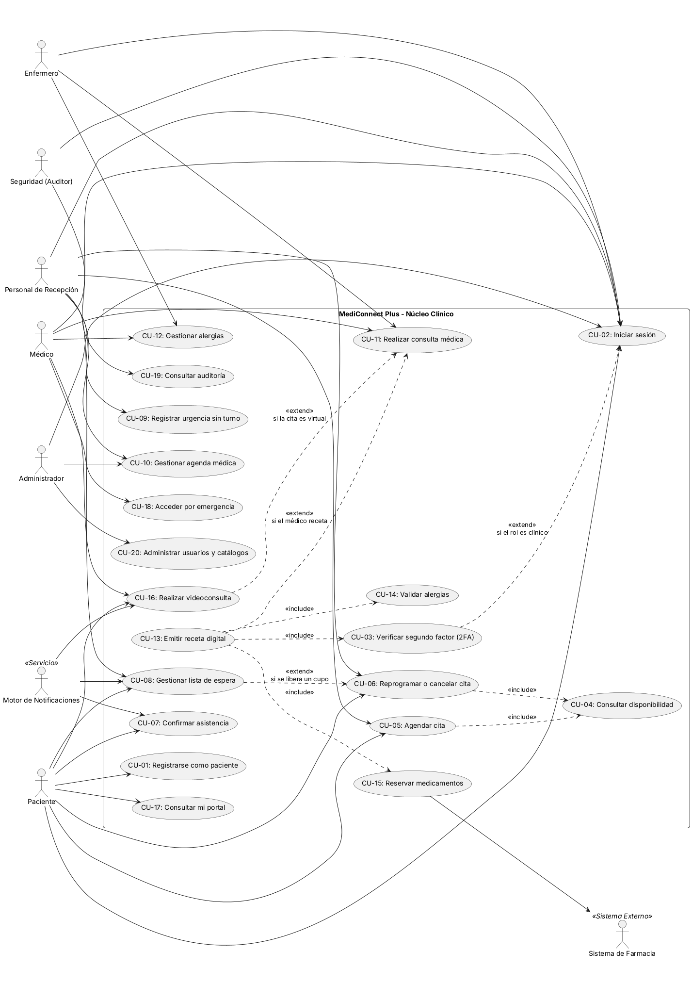

<details>
<summary>Ver código PlantUML</summary>

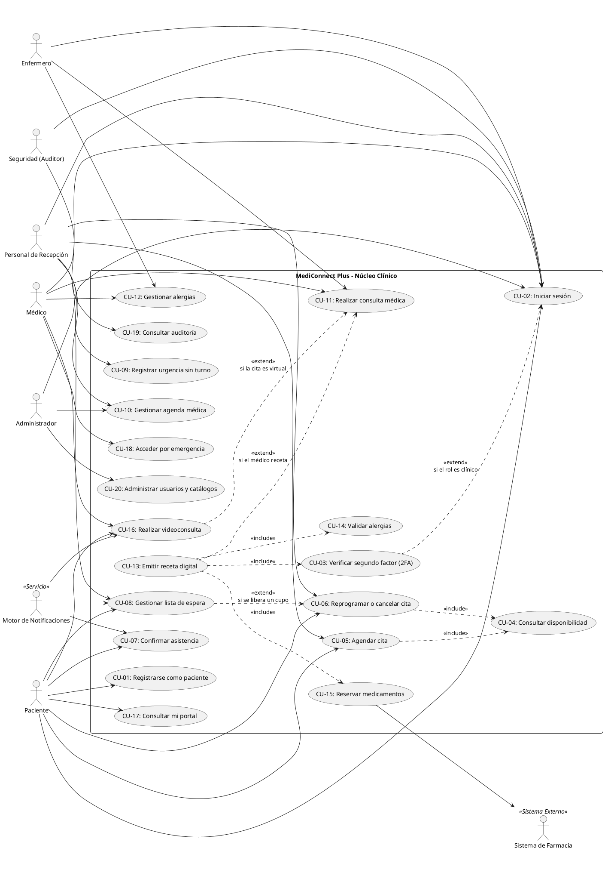

</details>

**Descripción breve de los casos de uso** (relacionen cada uno con los requisitos del bloque 1):

| Caso de uso | Actor principal | Requisitos que cubre |
|---|---|---|
| CU-01 Registrarse como paciente | Paciente | RF-01, RF-13, RES-01 |
| CU-02 Iniciar sesión | Todos los roles | RF-02, RF-03, RN-02 |
| CU-03 Verificar segundo factor (2FA) | Médico, Enfermero | RF-02, RN-01 |
| CU-04 Consultar disponibilidad | Paciente, Recepción | RF-04, RNF-02 |
| CU-05 Agendar cita | Paciente, Recepción | RF-05, RN-04, RN-05 |
| CU-06 Reprogramar o cancelar cita | Paciente, Recepción | RF-06, RF-07, RF-09, RN-05 |
| CU-07 Confirmar asistencia | Paciente | RF-08, RF-09 |
| CU-08 Gestionar lista de espera | Paciente, Recepción, Motor de Notificaciones | RF-10 |
| CU-09 Registrar urgencia sin turno | Recepción | RF-11 |
| CU-10 Gestionar agenda médica | Recepción, Administrador | RF-12 |
| CU-11 Realizar consulta médica | Médico, Enfermero | RF-14, RN-06, RN-07 |
| CU-12 Gestionar alergias | Médico, Enfermero | RF-15 |
| CU-13 Emitir receta digital | Médico | RF-17, RN-01, RN-09 |
| CU-14 Validar alergias | Sistema (Servicio Clínico) | RF-18 |
| CU-15 Reservar medicamentos | Sistema de Farmacia | RF-19, RES-03 |
| CU-16 Realizar videoconsulta | Paciente, Médico | RF-20, RF-21, RES-02 |
| CU-17 Consultar mi portal | Paciente | RF-16 |
| CU-18 Acceder por emergencia | Médico | RF-23 |
| CU-19 Consultar auditoría | Seguridad | RF-22, RN-02, RN-08 |
| CU-20 Administrar usuarios y catálogos | Administrador | RF-03 |

### 2.2 Modelo de dominio / diagrama de clases conceptual (mínimo 5 entidades)

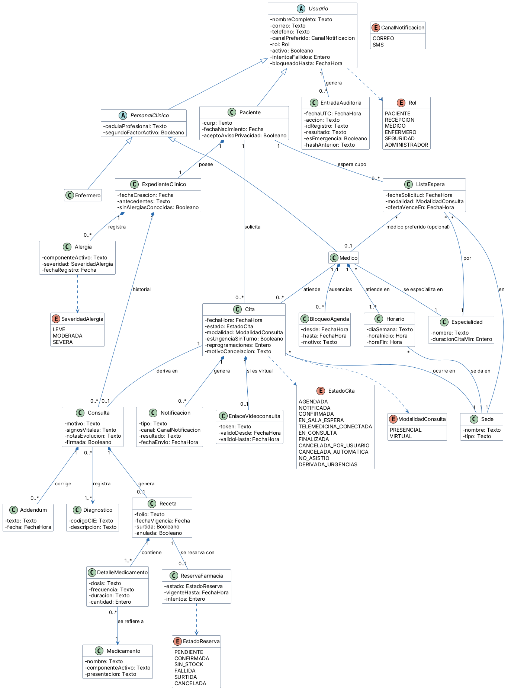

<details>
<summary>Ver código PlantUML</summary>

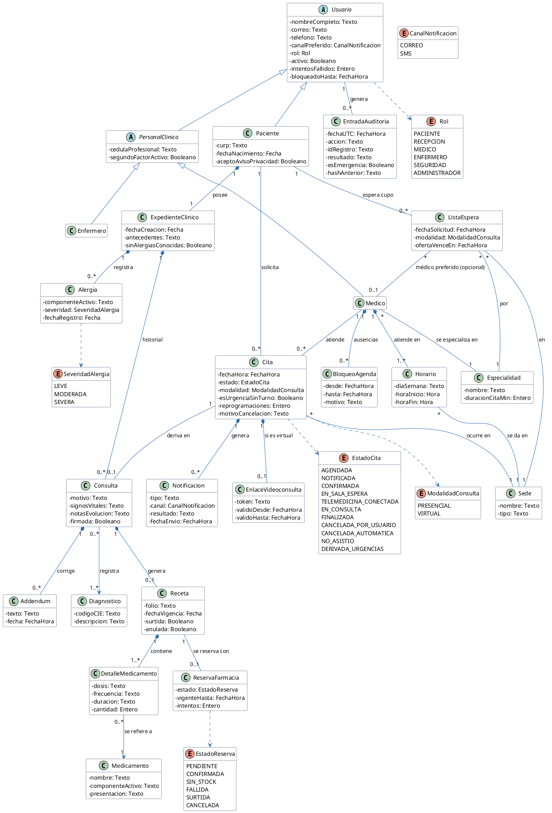

</details>

**Pregunta de revisión:** ¿cada entidad del modelo aparece mencionada en al menos un requisito de la tabla del bloque 1? Si no, falta un requisito o sobra una entidad.

> Sí. `Usuario`, `Paciente` y `Rol`: RF-01 a RF-03. `PersonalClinico`, `Medico` y `Enfermero`: RF-02, RF-14, RN-01. `Especialidad`, `Sede`, `Horario` y `BloqueoAgenda`: RF-04 y RF-12. `Cita`, `ModalidadConsulta` y `EstadoCita`: RF-05 a RF-11 y RN-03. `ListaEspera`: RF-10. `Notificacion`: RF-08. `EnlaceVideoconsulta`: RF-20. `ExpedienteClinico`: RF-13. `Alergia` y `SeveridadAlergia`: RF-15 y RF-18. `Consulta`, `Diagnostico` y `Addendum`: RF-14 y RN-06. `Receta`, `DetalleMedicamento` y `Medicamento`: RF-17. `ReservaFarmacia` y `EstadoReserva`: RF-19. `EntradaAuditoria`: RN-02 y RF-22.
>
> Cambios respecto a la plantilla original: se agregaron `Sede`, `Especialidad`, `BloqueoAgenda`, `Notificacion`, `EnlaceVideoconsulta`, `Alergia` (con severidad, para poder comparar con el componente activo del medicamento), `Addendum`, `ReservaFarmacia` y `EntradaAuditoria`. Se quitó el stock de `Medicamento` porque el inventario pertenece a la farmacia externa. Los tipos son conceptuales (Texto, Fecha, Entero); el desarrollador elige los tipos concretos de la base de datos.

### 2.3 Diagramas de secuencia

#### 2.3.1 Atención de consulta y emisión de receta

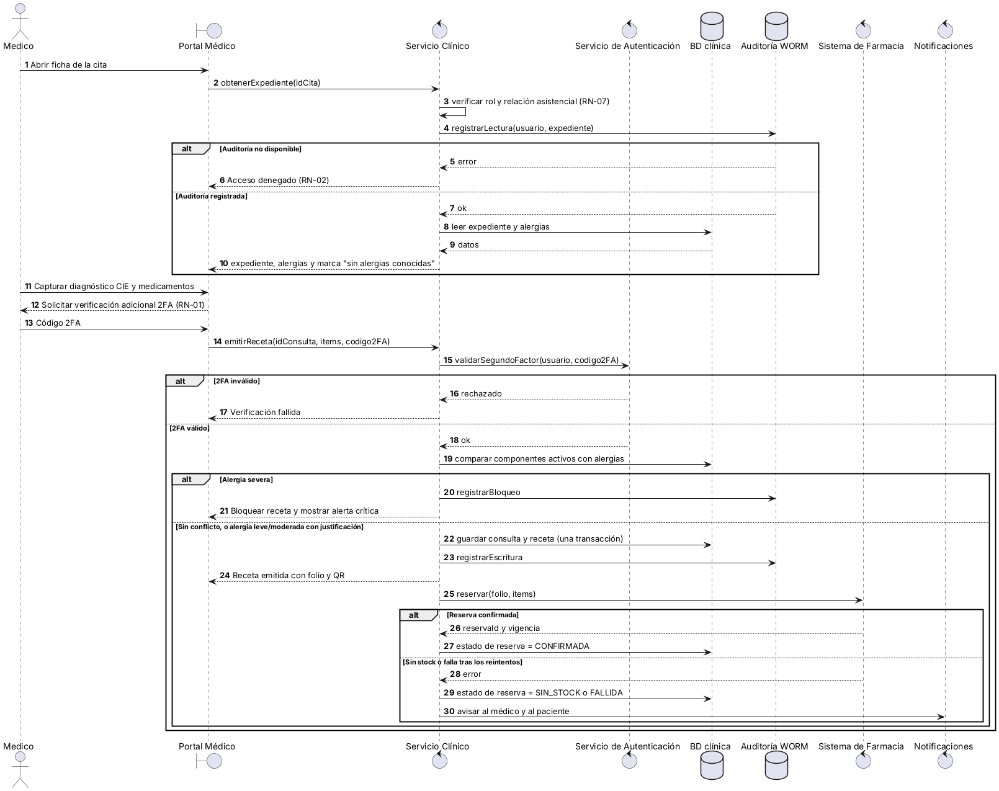

<details>
<summary>Ver código PlantUML</summary>

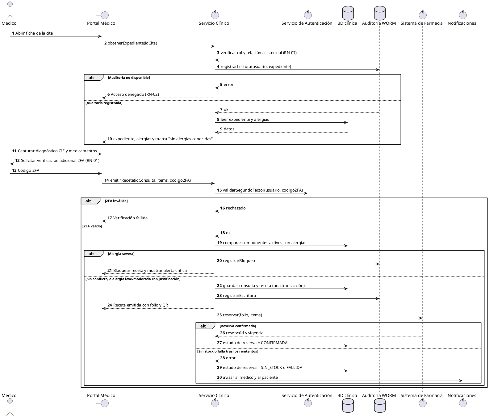

</details>

#### 2.3.2 Liberación automática de cupo y lista de espera

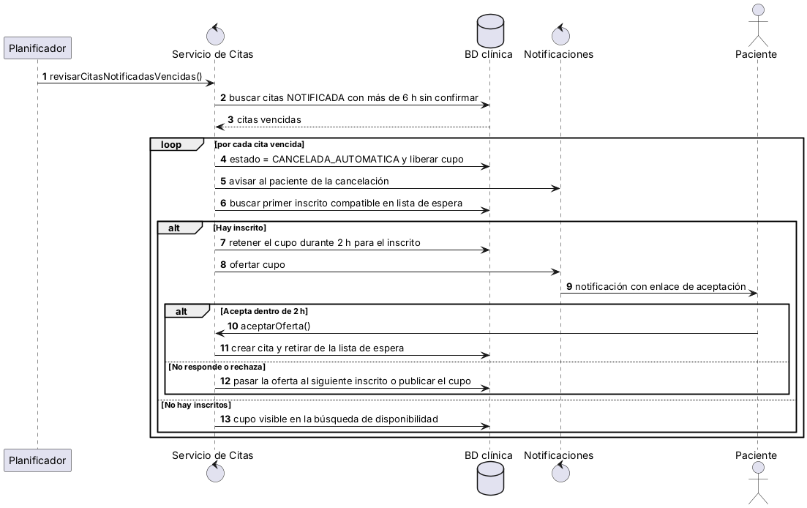

<details>
<summary>Ver código PlantUML</summary>

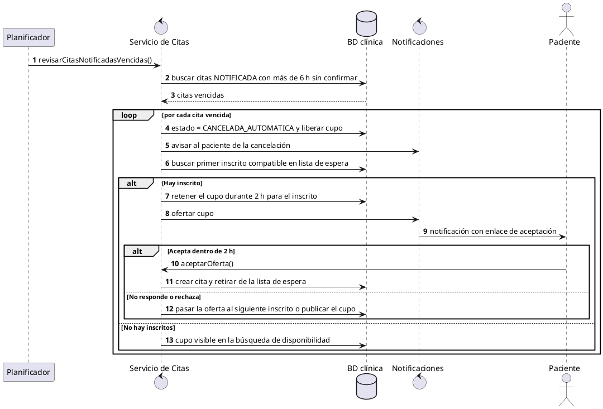

</details>

### 2.4 Diagrama de estados: ciclo de vida de una cita


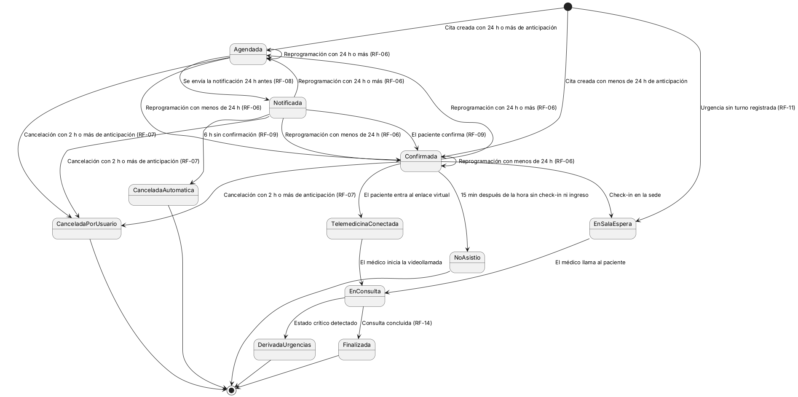

<details>
<summary>Ver código PlantUML</summary>

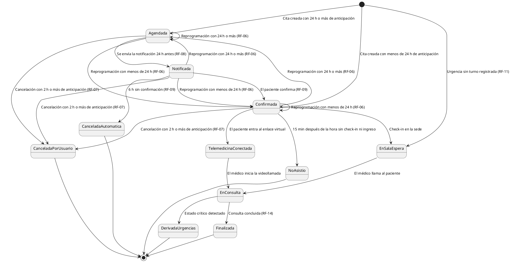

</details>

> **Regla de lectura (RN-03):** toda transición que no esté dibujada es inválida y el sistema debe rechazarla.

---

## Bloque 3. Diseño arquitectónico y asignación (40-50 min)

**Instrucciones:** propongan una arquitectura de alto nivel con **4 o más componentes** (por ejemplo: capas, cliente-servidor, microservicios) y asignen cada requisito al componente responsable.

### 3.1 Estilo arquitectónico elegido

| Estilo | Justificación (1-2 líneas) |
|---|---|
| Arquitectura en capas con servicios modulares (cliente-servidor) | Separa presentación, lógica y datos, y permite aislar los servicios críticos (autenticación, clínico) para darles mayor disponibilidad y auditoría, sin la complejidad de microservicios completos. |

### 3.2 Diagrama de componentes


<details>
<summary>Ver código PlantUML</summary>

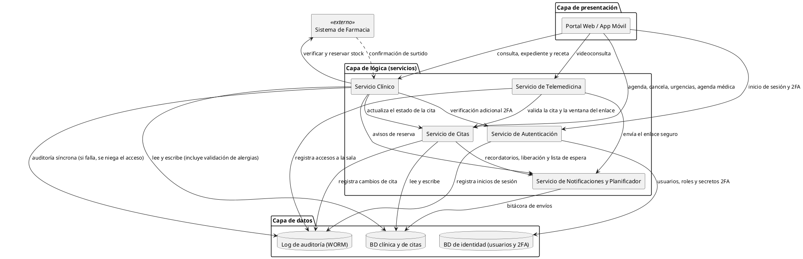

</details>

### 3.3 Matriz de trazabilidad (requisito → componente)

Marquen con una **X** el componente responsable de cada requisito. Ajusten las columnas a los componentes de su diagrama. La columna **BD** agrupa la BD clínica y de citas; la BD de identidad pertenece al Servicio de Autenticación.

| Requisito | Portal Web / App | Autenticación | Citas | Clínico | Telemedicina | Notificaciones | BD | Auditoría WORM | Farmacia (ext.) |
|---|:---:|:---:|:---:|:---:|:---:|:---:|:---:|:---:|:---:|
| RF-01 | X | X | | X | | X | X | | |
| RF-02 | X | X | | | | | | X | |
| RF-03 | X | X | X | X | X | | | X | |
| RF-04 | X | | X | | | | X | | |
| RF-05 | X | | X | | | X | X | | |
| RF-06 | X | | X | | | X | X | | |
| RF-07 | X | | X | | | X | X | | |
| RF-08 | | | X | | | X | X | | |
| RF-09 | X | | X | | | X | X | | |
| RF-10 | X | | X | | | X | X | | |
| RF-11 | X | | X | | | | X | | |
| RF-12 | X | | X | | | X | X | | |
| RF-13 | | | | X | | | X | X | |
| RF-14 | X | | | X | | | X | X | |
| RF-15 | X | | | X | | | X | X | |
| RF-16 | X | | X | X | | | X | X | |
| RF-17 | X | | | X | | | X | X | |
| RF-18 | | | | X | | | X | X | |
| RF-19 | | | | X | | X | X | | X |
| RF-20 | | | X | | X | X | | | |
| RF-21 | X | | X | | X | | | | |
| RF-22 | X | | | | | | | X | |
| RF-23 | X | | | X | | X | | X | |
| RNF-01 | X | X | X | X | X | X | X | X | |
| RNF-02 | | | X | | | | X | | |
| RNF-03 | | | | X | | | X | | |
| RNF-04 | | X | X | X | X | X | X | | |
| RNF-05 | X | | | | | | | | |
| RNF-06 | X | | | | | | | | |
| RNF-07 | | | | | | | X | X | |
| RNF-08 | X | X | X | X | X | X | | | |
| RNF-09 | | X | X | X | X | X | | | |
| RES-01 | X | X | | X | | | X | X | |
| RES-02 | X | | | | X | | | | |
| RES-03 | | | | X | | | | | X |
| RN-01 | X | X | | X | | | | | |
| RN-02 | | X | X | X | X | | | X | |
| RN-03 | | | X | X | X | | | | |
| RN-04 | | | X | | | | X | | |
| RN-05 | X | | X | | | | | | |
| RN-06 | | | | X | | | X | | |
| RN-07 | | X | | X | | | | | |
| RN-08 | | | | | | | X | X | |
| RN-09 | | | | X | | | | | X |

**Verificación:**

- [x] Todos los requisitos están asignados al menos a un componente
- [x] Todos los componentes tienen al menos un requisito asignado (si alguno no tiene, ¿para qué existe?)

### 3.4 Contrato de integración con el Sistema de Farmacia

Este contrato es una **propuesta del analista** para que el desarrollador pueda construir y probar localmente con una farmacia simulada. Debe validarse con el equipo del Sistema de Farmacia real. Por RES-03, no viaja ningún dato clínico.

| Operación | Sentido | Datos que viajan | Respuesta |
|---|---|---|---|
| Consultar stock | MediConnect a Farmacia | Lista de (código de medicamento, cantidad) | Por cada medicamento: disponible o no disponible |
| Reservar | MediConnect a Farmacia | Folio de receta, lista de (código de medicamento, cantidad), vigencia | ID de reserva y estado (confirmada, sin stock) |
| Cancelar reserva | MediConnect a Farmacia | ID de reserva | Confirmación |
| Notificar surtido | Farmacia a MediConnect | Folio de receta y fecha de surtido | Confirmación de recepción |

Condiciones comunes: TLS 1.3 con autenticación mutua, tiempo máximo de respuesta de 5 s por llamada, y reintentos según P-17. Las operaciones de reserva deben ser idempotentes (repetir la misma solicitud con el mismo folio no crea una segunda reserva).

### 3.5 Decisiones técnicas propuestas

Estas decisiones **no son requisitos del cliente**: son propuestas del analista para guiar al desarrollador, que puede cambiarlas si cumple los requisitos.

| # | Decisión propuesta | Requisitos a los que sirve |
|---|---|---|
| D-01 | Comunicación entre componentes por API REST sobre HTTPS, documentada con OpenAPI | RNF-01, RNF-09 |
| D-02 | Base de datos relacional con transacciones; el doble agendado se evita con una restricción de unicidad sobre (médico, fecha y hora) para citas activas | RF-05, RN-04 |
| D-03 | Auditoría en almacenamiento de solo inserción con hashes encadenados y escritura síncrona (si falla, se niega la operación) | RN-02, RNF-07 |
| D-04 | Tareas programadas (confirmaciones, liberación de cupos, ofertas de lista de espera) con un planificador idempotente y reintentos | RF-08, RF-09, RF-10 |
| D-05 | Segundo factor con TOTP (RFC 6238), compatible con aplicaciones autenticadoras estándar | RN-01, RF-02 |
| D-06 | Videoconsulta con WebRTC cifrado de extremo a extremo; el servicio solo hace la señalización y no almacena medios | RES-02, RF-20 |
| D-07 | Fechas en UTC en la base de datos y hora local de la sede en la interfaz | RF-05, RF-08 |
| D-08 | Para pruebas locales, la farmacia, el correo y el SMS se sustituyen por simuladores | RES-03, RF-08, RF-19 |

### 3.6 Tecnología de construcción

Indicada por el docente para la fase de construcción con un agente de IA desarrollador:

| Capa | Tecnología |
|---|---|
| Backend (servicios de la sección 3.2) | Node.js con Express |
| Frontend (Portal Web) | React con Vite |
| Base de datos | Relacional con transacciones (D-02); el motor lo elige el desarrollador |

**Supuesto:** en esta fase se construye el portal web adaptable a celular. La app móvil nativa de RNF-06 queda para una fase posterior (ver Anexo A, punto 13).

---

## Bloque 4. Negociación de requisitos (50-62 min)

**Instrucciones:**

1. Identifiquen **2 conflictos** entre requisitos o entre interesados (ejemplos: seguridad vs. usabilidad, costo vs. alcance, rendimiento vs. costo de infraestructura).
2. Realicen un **juego de roles de 6 minutos** por conflicto: dos integrantes defienden posiciones opuestas y los demás median.
3. Documenten el acuerdo con el formato WinWin: **conflicto → opciones → decisión → requisito modificado**.

### Conflicto 1

| Campo | Contenido |
|---|---|
| Requisitos o interesados en conflicto | RN-01 (2FA en todo acceso al expediente) vs. agilidad de la consulta (RF-14) |
| Posición A (quién y qué defiende) | Ing. Mónica Valdés (Seguridad): pedir 2FA en cada acceso al expediente para cumplir HIPAA |
| Posición B (quién y qué defiende) | Dra. Elena Ruiz (Dirección Médica) y médicos: un 2FA en cada apertura de expediente interrumpe la consulta y retrasa la atención |
| Opciones consideradas | 1. 2FA en cada acceso al expediente. <br> 2. 2FA solo al iniciar sesión, con sesión abierta todo el turno. <br> 3. 2FA al iniciar sesión, y verificación adicional solo para acciones críticas y tras inactividad. |
| Decisión tomada | Opción 3 |
| Justificación | Mantiene la protección en las operaciones de mayor riesgo y evita interrumpir la lectura normal durante la consulta. Cada acceso queda de todos modos auditado por RN-02. |
| Requisito modificado (ID y nuevo texto) | **RN-01:** El personal médico y de enfermería deberá autenticarse con 2FA al iniciar sesión. El sistema solicitará una verificación adicional antes de emitir una receta o modificar un diagnóstico, y tras 15 minutos de inactividad cerrará la sesión. |

### Conflicto 2

| Campo | Contenido |
|---|---|
| Requisitos o interesados en conflicto | RNF-04 (disponibilidad 99.9 %) vs. costo de infraestructura y alcance de la primera versión |
| Posición A (quién y qué defiende) | Ing. Mónica Valdés (Infraestructura): alta disponibilidad de 99.9 % en todos los servicios, porque es un sistema hospitalario |
| Posición B (quién y qué defiende) | Dirección de Transformación Digital: la redundancia completa de todos los servicios excede el presupuesto de la primera versión |
| Opciones consideradas | 1. Alta disponibilidad de 99.9 % en todos los servicios. <br> 2. Alta disponibilidad de 99.9 % solo en los servicios críticos y una meta menor para los demás. <br> 3. Servidor único con respaldos diarios. |
| Decisión tomada | Opción 2 |
| Justificación | La atención clínica depende de Autenticación, Servicio Clínico y BD. Citas y Notificaciones toleran una breve caída sin riesgo para el paciente. Se acota el costo sin comprometer la seguridad clínica. |
| Requisito modificado (ID y nuevo texto) | **RNF-04:** Los servicios de Autenticación, Clínico y la BD clínica tendrán una disponibilidad anual de 99.9 %. Los servicios de Citas, Telemedicina y Notificaciones tendrán 99.5 %. |

> **Riesgo registrado de este acuerdo:** con 99.5 %, Telemedicina puede estar caída unas 43.8 h al año. Como la telemedicina es parte central del proyecto, se recomienda revisar esta meta con la Dirección Médica antes de la versión 2 (ver Anexo A, punto 8).

> **Atención:** el docente puede pasar por su equipo como "cliente difícil" e introducir un cambio de último minuto. Registren aquí cómo lo manejaron.
>
> *(Notas sobre el cambio de último minuto: se llena en clase, si el docente lo plantea)*

---

## Bloque 5. Análisis formal de requisitos (62-75 min)

**Instrucciones:** elijan **3 requisitos críticos** (de prioridad *Must*) y reescríbanlos de forma no ambigua con una de estas plantillas.

**Plantilla EARS:**

```text
Cuando <evento o condición>, el sistema deberá <respuesta medible>.
```

**Plantilla Given/When/Then:**

```text
Dado <contexto inicial>
Cuando <acción del usuario o evento>
Entonces <resultado observable y medible>
```

### Requisito formal 1

| Campo | Contenido |
|---|---|
| ID original | RF-18 |
| Texto original (ambiguo) | El sistema debe avisar al médico si el medicamento es peligroso para el paciente. |
| Texto reescrito | **Dado** un paciente con una alergia severa registrada en su expediente a un componente activo, **cuando** el médico agrega a la receta un medicamento que contiene ese componente, **entonces** el sistema bloquea la emisión de la receta y muestra una alerta crítica con el nombre del componente en 2 segundos o menos. Si la alergia es leve o moderada, advierte y solo permite continuar con una justificación escrita del médico. |
| Criterio de aceptación medible | En una prueba con 20 casos de alergia severa, el 100 % se bloquea y no se genera ningún folio de receta. La alerta aparece en 2 s o menos en al menos el 95 % de los casos. En los casos leve o moderada, ninguna receta se emite sin justificación. |

### Requisito formal 2

| Campo | Contenido |
|---|---|
| ID original | RF-05 |
| Texto original (ambiguo) | El sistema debe permitir agendar citas de forma fácil y rápida. |
| Texto reescrito | **Cuando** un paciente o recepcionista confirme una solicitud de cita con especialidad, sede, médico y cupo libre, el sistema deberá registrar la cita, ocupar ese cupo y mostrar el comprobante en 3 segundos o menos. |
| Criterio de aceptación medible | El 95 % de las solicitudes se confirma en 3 s o menos. Si dos usuarios solicitan el mismo cupo al mismo tiempo, el sistema acepta una sola y rechaza la otra con un mensaje. |

### Requisito formal 3

| Campo | Contenido |
|---|---|
| ID original | RNF-01 |
| Texto original (ambiguo) | La información médica debe viajar y guardarse de forma segura. |
| Texto reescrito | **Cuando** el sistema transmita información, deberá usar exclusivamente TLS 1.3, y **cuando** almacene datos clínicos, de identidad o respaldos, deberá cifrarlos con AES-256. |
| Criterio de aceptación medible | Un escaneo de configuración TLS no detecta ningún punto de acceso con versión menor a 1.3. La revisión de la BD y de los respaldos confirma que el 100 % de los datos clínicos, de identidad y de los respaldos está cifrado con AES-256. |

### Lista de verificación de calidad

Marquen con una **X** si el requisito cumple. Si algún cuadro queda vacío, corrijan el requisito.

| Criterio | Req. 1 | Req. 2 | Req. 3 |
|---|:---:|:---:|:---:|
| **Completo:** no le falta información para implementarlo | X | X | X |
| **Consistente:** no contradice otro requisito | X | X | X |
| **Verificable:** se puede probar con un criterio medible | X | X | X |
| **No ambiguo:** admite una sola interpretación | X | X | X |
| **Trazable:** tiene ID y está asignado a un componente | X | X | X |

> **Señales de ambigüedad:** palabras como *rápido*, *fácil*, *adecuado*, *amigable*, *etc.*, *y/o*, *normalmente*. Sustitúyanlas por cifras (por ejemplo, "en menos de 2 segundos para el 95 % de las consultas").

---

## Anexo A. Puntos abiertos, supuestos y riesgos

Estos puntos **no los resolvió el cliente**. Donde se indica una decisión provisional, es un supuesto del equipo de análisis para que el desarrollo pueda avanzar, y debe confirmarse.

| # | Punto abierto | Por qué importa | Decisión provisional | Quién valida |
|---|---|---|---|---|
| 1 | Versión del catálogo de diagnósticos: el documento pide CIE-11, pero la norma de expediente clínico electrónico en México podría exigir otra versión | Cambia el catálogo y la validación de RF-14 | El catálogo de diagnósticos es configurable y se carga con la versión que se confirme | Dirección Médica y Legal |
| 2 | Normas aplicables: se menciona HIPAA (EE. UU.) y una ley de datos personales sin precisar | Define aviso de privacidad, consentimientos y retención (RES-01, P-12, P-13) | Se asume LFPDPPP vigente, NOM-004-SSA3 y NOM-024-SSA3, además de HIPAA | Legal |
| 3 | 2FA para cuentas con privilegios: RN-01 negociada solo cubre personal médico y de enfermería | Seguridad y Administrador tienen acceso a auditoría y configuración | Se mantiene RN-01 como se negoció; se recomienda extender el 2FA a Seguridad y Administrador | Seguridad |
| 4 | Pacientes menores de edad o sin capacidad legal: no hay flujo de tutor | Una red hospitalaria atiende a menores; el registro con CURP propia no aplica | No cubierto por este documento. Propuesta: un tutor adulto registra y agenda a nombre del menor (por diseñar) | Dirección Médica y Legal |
| 5 | Aviso de privacidad y consentimiento informado, incluido el de telemedicina | Obligación legal y evidencia ante auditoría | El aviso se acepta en RF-01; el consentimiento de telemedicina se pediría antes de la primera videoconsulta (por diseñar) | Legal |
| 6 | Contrato real y ambiente de pruebas del Sistema de Farmacia | La sección 3.4 es una propuesta | Se desarrolla contra una farmacia simulada | Farmacia |
| 7 | Proveedores de correo y SMS, y costo por envío | RF-08 y RF-09 dependen de ellos | Se usan simuladores en desarrollo | Transformación Digital |
| 8 | Meta de 99.5 % para Telemedicina frente a su importancia en el proyecto | Hasta 43.8 h de caída al año | Se mantiene lo negociado (RNF-04); se recomienda revisarla antes de la versión 2 | Dirección Médica |
| 9 | Zonas horarias de las sedes | Afecta la hora de citas, notificaciones y ventanas de tiempo | Se guarda en UTC y se muestra en la hora local de la sede (D-07) | Transformación Digital |
| 10 | Qué parte del historial puede ver el paciente | RF-16 asume que no ve las notas de evolución internas | Se muestra solo fecha, médico y diagnósticos | Dirección Médica |
| 11 | Paciente de urgencias que no puede identificarse | RF-11 pide datos mínimos y un expediente único por CURP | Se propone un registro temporal que luego se fusiona con el expediente real (por diseñar) | Dirección Médica |
| 12 | Valores marcados "Supuesto" en la tabla 1.2 | Son reglas de negocio que el cliente no definió | Se usan los valores de la tabla como configuración inicial | Carlos Mendoza, Dirección Médica y Seguridad |
| 13 | App móvil nativa (RNF-06) frente a la tecnología indicada (React con Vite, solo web) | Con esa tecnología solo se construye el portal web | Se construye el portal adaptable a celular y la app nativa queda para otra fase | Docente y Transformación Digital |

---

## Cierre (75-80 min)

- [x] Revisamos que los 6 diagramas se vean en GitHub (imágenes en `img/`, con el código PlantUML en cada desplegable)
- [x] Revisamos que las tablas se vean correctamente en la vista previa
- [ ] Exportamos el documento a PDF
- [ ] Subimos el entregable
- [ ] El relator preparó su conclusión oral de 1 minuto

### Conclusión del relator

**Principal hallazgo o riesgo detectado durante el análisis:**

> El mayor riesgo es el choque entre seguridad (2FA, auditoría, cifrado) y la agilidad de la atención clínica: si la seguridad frena al médico en consulta, el sistema no se usará, y si se relaja, se incumple HIPAA. La solución fue pedir 2FA al iniciar sesión y verificar de nuevo solo en acciones críticas.

---

## Rúbrica de evaluación (100 puntos)

| Criterio | Excelente | Suficiente | Insuficiente | Puntos |
|---|---|---|---|:---:|
| **Clasificación y priorización** | 12+ requisitos, bien clasificados, con ISO 25010 y MoSCoW coherente (18-20) | 8-11 requisitos o errores menores de clasificación (12-17) | Menos de 8 o clasificación incorrecta (0-11) | /20 |
| **Modelos conceptuales** | Ambos modelos completos, coherentes entre sí y con los requisitos (18-20) | Modelos incompletos o con inconsistencias leves (12-17) | Falta un modelo o no se relacionan con los requisitos (0-11) | /20 |
| **Arquitectura y trazabilidad** | 4+ componentes, matriz completa y sin requisitos huérfanos (18-20) | Matriz con algunos requisitos sin asignar (12-17) | Sin matriz o arquitectura incoherente (0-11) | /20 |
| **Negociación documentada** | 2 conflictos reales, con opciones, decisión justificada y requisito modificado (18-20) | 2 conflictos con justificación débil, o solo 1 completo (12-17) | Conflictos superficiales o sin decisión documentada (0-11) | /20 |
| **Formalización y calidad** | 3 requisitos en EARS/GWT, medibles y con lista de verificación aplicada (14-15) | Requisitos reescritos pero con criterios poco medibles (9-13) | Sin reescritura o siguen siendo ambiguos (0-8) | /15 |
| **Organización y trabajo en equipo** | Documento ordenado, PlantUML renderiza, roles cumplidos (5) | Detalles menores de formato (3-4) | Documento desordenado o sin renderizar (0-2) | /5 |
| | | | **TOTAL** | **/100** |

**Retroalimentación del docente:**

> &nbsp;
>
> &nbsp;
